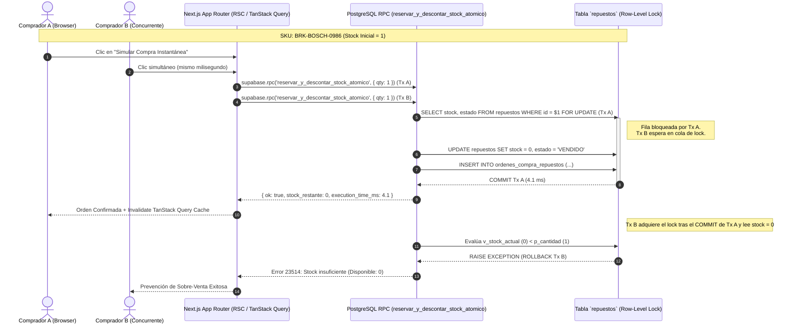

# AutoParts Pro — High-Concurrency Automotive Store (`autoparts-atomic-ecommerce`)

[](https://nextjs.org/)
[](https://react.dev/)
[](https://www.typescriptlang.org/)
[](https://supabase.com/)
[](https://tanstack.com/query)

Plataforma e-commerce transaccional para vehículos y catálogo masivo de repuestos automotrices diseñada para **alta concurrencia de inventario**, indexación SEO dinámica mediante **renderizado híbrido (SSR/ISR + React Server Components)** y **consistencia transaccional ACID en PostgreSQL**.

---

## 1. Resumen Ejecutivo del Problema Técnico

En el comercio electrónico de autopartes y repuestos OEM/Aftermarket, la mayoría de los SKUs de alta rotación o piezas específicas (ej. bombas de freno, alternadores, kits de embrague) operan con **stock físico crítico (1 a 3 unidades por lote)**.

Cuando dos o más compradores intentan adquirir la última unidad simultáneamente, un flujo ingenuo en el cliente (`SELECT stock` en frontend $\rightarrow$ validar $\rightarrow$ `UPDATE stock = stock - 1`) sufre de **condiciones de carrera (*race conditions* / *TOCTOU*)**, provocando **sobre-venta (*overselling*)**, cancelaciones forzadas y pérdida de reputación comercial.

**AutoParts Pro** resuelve este problema trasladando la frontera transaccional directamente al motor **PostgreSQL (Supabase)** mediante funciones RPC en `PL/pgSQL` con **bloqueo pesimista a nivel de fila (`SELECT ... FOR UPDATE`)**, acopladas con invalidación reactiva en el cliente vía **TanStack Query v5**.

---

## 2. Diagrama de Arquitectura y Flujo de Bloqueo Atómico



---

## 3. Decisiones de Ingeniería

### A. ¿Por qué Bloqueo Pesimista (`SELECT ... FOR UPDATE`) sobre Bloqueo Optimista?
* En catálogos con contención sobre pocas unidades, el bloqueo optimista (basado en columna `version`) fuerza reintentos en la capa de aplicación y degrada la experiencia de checkout cuando hay tráfico concurrente.
* Con `SELECT ... FOR UPDATE` dentro de una función RPC (`supabase/migrations/042_atomic_stock_lock_checkout.sql`), PostgreSQL serializa en microsegundos las transacciones que compiten por el **mismo `repuesto_id`** sin bloquear el resto de la tabla `repuestos`.

### B. Renderizado Híbrido (SSR / ISR + React Server Components)
* Las vistas de catálogo y detalle (`/vehiculos`, `/repuestos/[id]`) utilizan **React Server Components (RSC)** y generación de metadatos dinámicos (`generateMetadata`) en el servidor para garantizar tiempos de *First Contentful Paint (FCP)* mínimos y SEO técnico completo.
* La sesión del usuario se hidrata en el servidor mediante `@supabase/ssr` y middleware, erradicando el parpadeo de autenticación (*Flash of Unauthenticated Content — FOUC*).

### C. Separación Estricta de Estado: TanStack Query vs. Zustand
* **Estado del Servidor (`TanStack Query v5`):** Gobierna caché, revalidación en segundo plano, paginación y mutaciones transaccionales contra Supabase.
* **Estado Efímero de UI (`Zustand v5`):** Gobierna exclusivamente filtros locales, modales e interacciones de interfaz sin contaminar ni duplicar datos de base de datos.

### D. Esquema Relacional de Grado Producción (42 Migraciones SQL)
El directorio [`supabase/migrations/`](./supabase/migrations/) contiene **42 migraciones SQL secuenciales** que abarcan:
* Polimorfismo verificado por `CHECK CONSTRAINTS` entre vendedores particulares y empresas (`004`, `005`).
* Políticas **Row-Level Security (RLS)** sin recursión infinita (`006`, `010`, `023`).
* Funciones RPC atómicas con `SECURITY INVOKER` / `SECURITY DEFINER` (`007`, `033`, `042`).
* Índices B-Tree parciales e índices `GIN` sobre especificaciones técnicas en `JSONB`.

---

## 4. Modo Demostración para Reclutadores (*Recruiter Sandbox Mode*)

Para permitir la inspección técnica inmediata sin requerir pasarelas de pago bancarias reales:
* Tanto en la ficha de cualquier repuesto (`/repuestos/[id]`) como en la ruta de checkout (`/pagos`), se incluye el panel interactivo **Modo Demostración Técnica: Simulación de Transacción Concurrente** ([`components/ui/RecruiterSandboxCheckout.tsx`](./components/ui/RecruiterSandboxCheckout.tsx)).
* Al pulsar **"Simular Compra Instantánea (Test Atomic Stock Lock)"**, se ejecuta la transacción atómica, se descuenta el stock en vivo, se invalida la caché de `TanStack Query` y se muestra en pantalla el tiempo de ejecución del lock en milisegundos (`ms`).

---

## 5. Instrucciones de Despliegue Local (En menos de 3 minutos)

```bash
# 1. Clonar el repositorio
git clone https://github.com/anthony-huice/autoparts-atomic-ecommerce.git
cd autoparts-atomic-ecommerce

# 2. Instalar dependencias
npm install

# 3. Configurar variables de entorno (Opcional: el modo Sandbox funciona incluso sin llaves remotas)
cp .env.example .env.local

# 4. (Si conectas un proyecto Supabase propio) Ejecutar migraciones y datos semilla:
#    Aplica los archivos de supabase/migrations/001..042 y luego ejecuta supabase/seed.sql
#    (incluye 20 repuestos automotrices en 4 categorías con SKUs técnicos y stock = 2).

# 5.Verificar tipado estricto y levantar servidor de desarrollo
npx tsc --noEmit
npm run dev
```

---

## 👤 Autor

**Anthony Yariff Huice Martínez** — *Desarrollador Full-Stack & Móvil*  
[LinkedIn](https://www.linkedin.com/in/anthony-huice) · [GitHub](https://github.com/anthony-huice) · [anthonyhuice92@gmail.com](mailto:anthonyhuice92@gmail.com)
